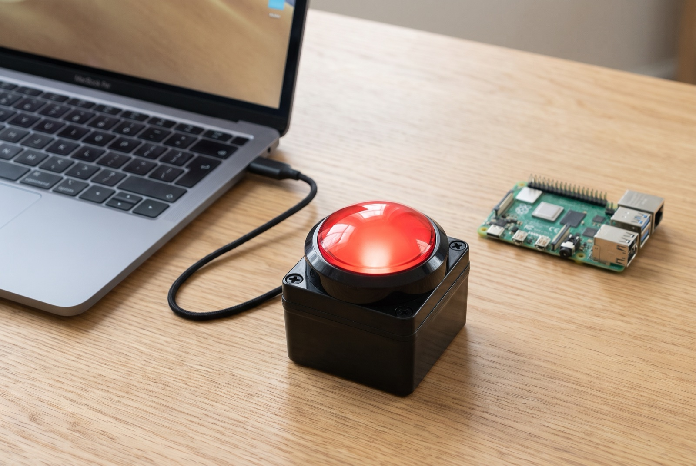
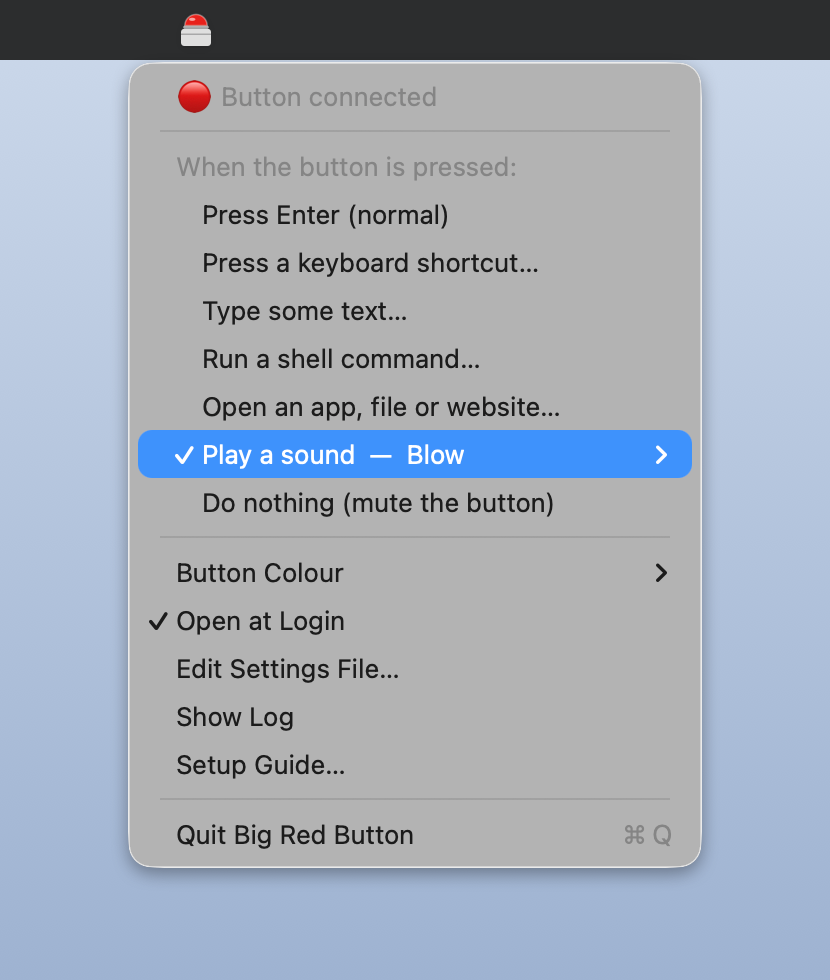
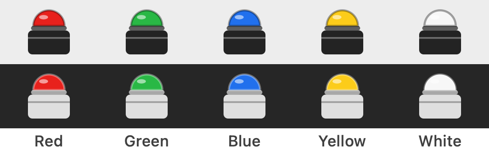

# Big Red Button



Setup software for the Big Game Button with Enclosure 100mm USB from Little Bird Electronics, in [red](https://littlebirdelectronics.com.au/products/big-game-button-with-enclosure-100mm-usb-c), [green](https://littlebirdelectronics.com.au/products/big-game-button-with-enclosure-100mm-usb-green), [blue](https://littlebirdelectronics.com.au/products/big-game-button-with-enclosure-100mm-usb-blue), [yellow](https://littlebirdelectronics.com.au/products/big-game-button-with-enclosure-100mm-usb-yellow) and [white](https://littlebirdelectronics.com.au/products/big-game-button-with-enclosure-100mm-usb-white). Setup guide: <https://littlebirdelectronics.com.au/projects/big-game-button-setup>.

Out of the box the button is a one-key USB keyboard: press it and it types **Enter**. This software makes it do something else (a buzzer sound, a keyboard shortcut, a command, a website), and only for the button. Your normal keyboard's Enter key keeps working.

| | |
|---|---|
| **macOS** 13+ | Menu bar app. No drivers, no system extensions, no SIP changes. |
| **Linux / Raspberry Pi** | `bigredbutton` service (Go, static binary) for Pi OS 32/64-bit, Ubuntu, Debian… |
| **Windows** | [Guide](windows/README.md) using free remapping tools |

## Install (macOS and Linux / Raspberry Pi)

```sh
curl -fsSL https://littlebirdelectronics.com.au/install/big-red-button.sh | bash
```

> **Use the USB-A to USB-C cable that came with the button.** The button doesn't power up on a USB-C to USB-C cable. If your computer only has USB-C ports, use a USB-C to USB-A adapter or hub.

### macOS

The installer puts **Big Red Button.app** in Applications and opens it. Look for the little button in the menu bar; **Button Colour** matches it to your button.





1. macOS asks to let Big Red Button **receive keystrokes** (Input Monitoring). Click **Open System Settings** and switch **Big Red Button** on. This is how the app sees the button being pressed.
2. Plug the button in and press it. You'll hear a game-show buzzer.
3. Click the menu bar button to choose what the button does:
   - **Press a keyboard shortcut**: record any shortcut, e.g. ⌘⇧4 or Space. The keys stay held while the button is held, so it works as push-to-talk.
   - **Type some text**
   - **Run a shell command**, e.g. `say "Time's up"`, `shortcuts run "My Shortcut"`, `open -a Calculator`
   - **Open an app, file or website**
   - **Play a sound**: Buzzer, Ding or any macOS system sound
   - **Press Enter (normal)** or **Do nothing**

Shortcuts and typing need one more permission, **Accessibility**, which the app asks for when you pick those options. The app starts at login. Settings live in `~/Library/Application Support/BigRedButton/config.json`.

**How it works:** the app watches the button over USB HID (Input Monitoring) and uses macOS's built-in per-device key remapping (the mechanism behind `hidutil`) to silence the button's own Enter key. Nothing is installed outside the app, and quitting the app turns the button back into a plain Enter key. If the app is force-quit or crashes, the button stays silent until you unplug it and plug it back in, or open the app again.

### Linux and Raspberry Pi

The installer adds `/usr/local/bin/bigredbutton` and a `bigredbutton` systemd service. The button keeps pressing Enter until you tell it otherwise:

```sh
sudo bigredbutton set command "aplay /usr/share/sounds/alsa/Front_Center.wav"   # play a sound
sudo bigredbutton set command "rpicam-still -o /home/pi/photo-\$(date +%s).jpg" # take a photo
sudo bigredbutton set command "python3 /home/pi/button.py"                      # run your script
sudo bigredbutton set keys "space"       # press a key (held while the button is held)
sudo bigredbutton set keys "ctrl+alt+t"  # press a shortcut
sudo bigredbutton set text "Hello!"      # type text
sudo bigredbutton set enter              # back to a normal Enter key

sudo bigredbutton test                   # try the action without pressing the button
bigredbutton status                      # is the button connected?
sudo bigredbutton listen                 # show presses live (stop the service first)
sudo journalctl -u bigredbutton -f       # service log
```

Commands run as the user who ran the installer. If that was a root shell you opened with `sudo` or `su`, they run as the account you logged in with, not root. The service grabs the button exclusively, so its Enter key never reaches other programs. Settings live in `/etc/bigredbutton.json`. See [linux/README.md](linux/README.md) for more.

### Windows

See [windows/README.md](windows/README.md).

## Uninstall

```sh
curl -fsSL https://littlebirdelectronics.com.au/install/big-red-button.sh | bash -s -- --uninstall
```

## Settings file

macOS and Linux use the same format ([example](config.example.json)):

```json
{
  "action": "keys",
  "keys": "cmd+shift+4"
}
```

| `action` | Uses | What happens |
|---|---|---|
| `enter` | | The button is a normal Enter key (default) |
| `keys` | `keys` | Presses a shortcut such as `ctrl+alt+t`, `space`, `f13` or `playpause`. Held while the button is held. |
| `text` | `text` | Types the text |
| `command` | `command` | Runs a shell command |
| `open` | `open` | macOS only: opens an app name, file path or URL |
| `sound` | `sound` | macOS only: `Buzzer`, `Ding`, a system sound name or a file path |
| `none` | | Does nothing (mutes the button) |

Key names: `ctrl`, `alt`/`option`, `shift`, `cmd`/`super`/`win`, `a`–`z`, `0`–`9`, `f1`–`f20`, `enter`, `space`, `tab`, `esc`, `backspace`, `delete`, `up`, `down`, `left`, `right`, `home`, `end`, `pageup`, `pagedown`, `minus`, `equal`, `comma`, `period`, `slash`, `semicolon`, `quote`, `grave`, `leftbracket`, `rightbracket`, `backslash`, and media keys `volumeup`, `volumedown`, `mute`, `playpause`, `next`, `previous`.

## Troubleshooting

- **Nothing happens, and the button doesn't light up when pressed:** it isn't getting power. Use the supplied USB-A to USB-C cable.
- **On a Mac the button lights up but does nothing, and the menu bar icon is gone:** the app isn't running (for example it was force-quit), so the button is still silenced. Open Big Red Button again, or unplug the button and plug it back in to get a plain Enter key.
- **macOS menu says "Needs Input Monitoring permission":** System Settings → Privacy & Security → Input Monitoring → switch on Big Red Button.
- **macOS shows "Keyboard Setup Assistant" when the button is plugged in:** close it. The button is a one-key keyboard and can't answer it.
- **You also use Karabiner-Elements on macOS:** in Karabiner's Devices settings, turn off "Modify events" for *USB Keyboard (LinTx)*.
- **Linux: `bigredbutton status` says not connected:** run `lsusb` and look for `8189:0019`. Check the cable.

## Under the hood

The button identifies as `LinTx USB Keyboard`, USB ID `8189:0019`, and sends HID keyboard usage 0x28 (Enter). [docs/hardware.md](docs/hardware.md) has the full probe: descriptors, reports, and why USB-C to USB-C cables don't work.

## Building from source

- macOS: `cd macos && ./build.sh` (needs Xcode command line tools; set `SIGN_ID=-` to build without the Little Bird signing certificate)
- Linux: `cd linux && ./build.sh` (needs Go)

MIT licensed. Made by [Little Bird Electronics](https://littlebirdelectronics.com.au).
